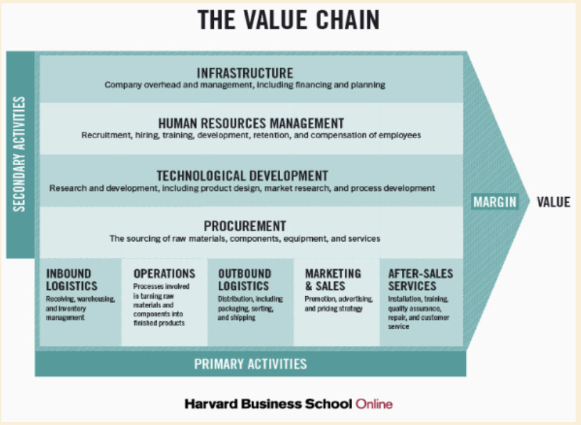
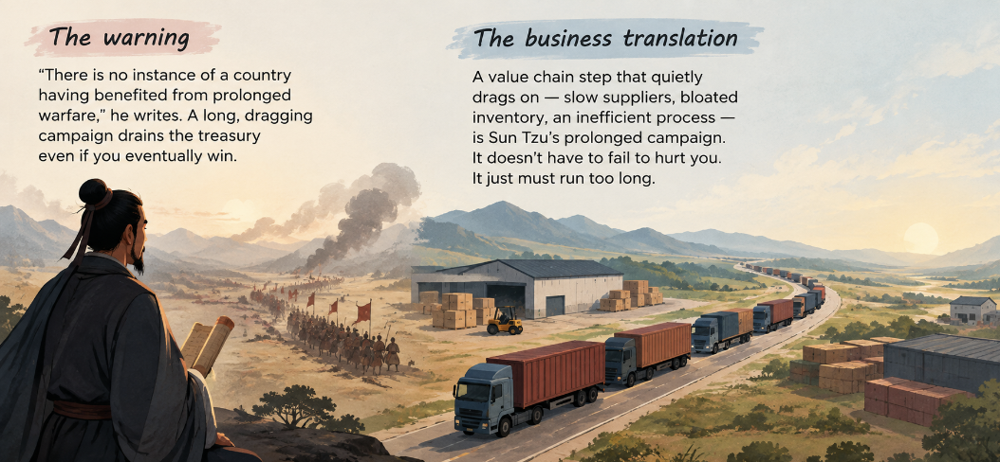
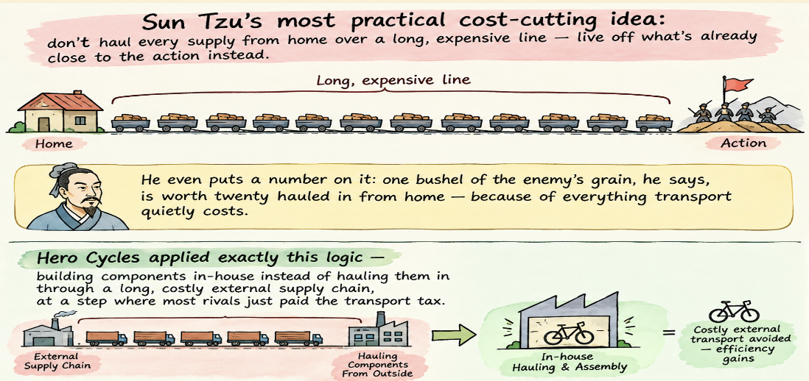
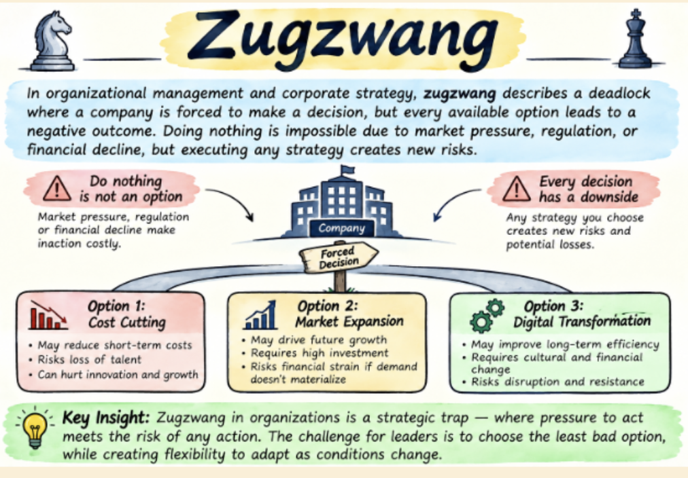

# Week 3 Session 12: Value Chain & Cost Analysis

---

## 1. Core Concept: What Is a Value Chain?

* Every step a business takes to turn raw inputs into something a customer will pay for — and each step either **adds value** or/and **adds cost**.

### Why Hero Cycles Cared About Every Link

* Most bicycle makers bought parts and assembled them.
* Hero went further back in the chain, **making more components itself**, so it controlled quality and cost at more steps than its rivals could.

---

## 2. Primary Activities

Activities that touch the product directly:

* **Inbound Logistics**: Getting raw materials in.
* **Operations**: Turning inputs into the product.
* **Outbound Logistics**: Getting the product to customers.
* **Marketing & Sales**: Convincing people to buy.
* **Aftersales**: Supporting the customer after the sale.

---

## 3. Support Activities

Activities that hold everything up:

* **Procurement**: Buying what the business needs, well.
* **Technology Development**: Improving how things get done.
* **Human Resource Management**: Hiring, training, and keeping good people.
* **Infrastructure**: The systems that hold everything together.

> *Support activities don’t deal with the product directly — but without them, the primary activities fall apart.*

---

## 4. Mapping the Value Chain: Boncho’s Momos

* **Inbound**: Buying vegetables and flour each morning.
* **Operations**: Prepping and steaming the momos.
* **Outbound + Sales**: Serving customers at the cart, and maybe, delivery.

---

## 5. What Is Cost Analysis?

* Figuring out exactly where money is spent across the value chain — and whether each step earns its cost back.
* **Cost vs. Value Rule**:
  * A step that costs a lot but adds little value to the customer is a target for cutting.
  * A step that costs a little but creates a lot of value is worth protecting, even growing.
* **Hero Cycles Example**: Hero's in-house component manufacturing lowered cost at a step most rivals treated as an expensive external purchase.

> *Based on: A. Nag, Strategic Management: Analysis, Implementation and Control, Ch. 5.*

---

## 6. Case Study: A ₹50,000 Loan to World's Largest Bicycle Maker (Hero Cycles)

* **1956, Ludhiana**: Four Munjal brothers, having traded bicycle parts since the 1940s, take a bank loan of about ₹50,000 to start Cycles company.
* **The Advantage Nobody Could See from Outside**: Rather than buying components from outside suppliers, they built deep in-house manufacturing capability for parts most rivals bought externally — tightening quality and cutting costs at every step.
* **By 1986**: The company entered the Guinness Book of World Records as the world's largest bicycle manufacturer — built not on one clever idea, but on controlling its entire value chain.

---

## 7. From the Reading: Sun Tzu, Ch. II — Economics of War

* **“Forage on the Enemy” — The Value Chain Lesson**:

  * Sun Tzu warned that a dragged-out campaign drains resources even without losing — the same is true of an inefficient value chain step.
  * A lean cost structure isn't a limitation, it's a weapon.

  

---

## 8. Why This Matters for a Founder

1. **Cost Visibility**: Most founders know their total costs but not where in the chain those costs sit.
2. **Targeted Fixes**: A value chain view shows exactly which step to fix first, instead of cutting costs everywhere at once.
3. **Controlling Links**: Hero's advantage wasn't a single genius idea — it was controlling one link in the chain better than anyone else.

---

## 9. Class Activity: Find the Cost Advantage

Walk through any business's value chain:

* Which step costs the most, honestly?
* Which step does the customer notice and value?
* Find one step where it could cut cost without losing customer value.

---

## 10. Term of the Day: Zugzwang

A deadlock situation where a player is legally obligated to make a move, but every available move worsens their position or leads to inevitable defeat.

### Causes:

* **Strategic Inertia**: Ignoring market shifts (like Kodak ignoring digital photography) until only bad choices remain.
* **Over-Regulation**: Compliance frameworks that trap a business between legal penalties and operational paralysis.
* **Sunk Cost Fallacy**: Pouring resources into a failing project until it becomes too big to abandon safely, yet too broken to fix.

### Cure:

* **Introduce a Third Variable**: If Option A and Option B are both fatal, pivot to a completely new market, product line, or business model.
* **Buy Time**: Outsource the problem or form a strategic partnership to shift the risk and delay the forced decision.
* **Controlled Sacrifice**: Accept that a loss is inevitable. Choose the option with the most predictable damage, take the hit early, and preserve resources to rebuild.

---

## 11. Key Takeaways & Summary

* A value chain is every step that turns inputs into something customers will pay for.
* Primary activities touch the product directly; support activities hold everything up.
* Cost analysis finds where money is spent — and whether each step earns it back.
* Sun Tzu warned that a dragged-out campaign drains resources even without losing — the same is true of an inefficient value chain step.
* Hero Cycles built a world-record business by controlling one link in the chain better than rivals.

---

## 12. References & Next Session

* **Required Reading**: A. Nag — *Strategic Management: Analysis, Implementation and Control*, Ch. 5 & 7.
* **Case & History Sources**: Case: Hero Cycles (Value Chain), Sun Tzu — *The Art of War*, Ch. II.
* **Term for Next Session**: *Pyrrhic Victory*.
